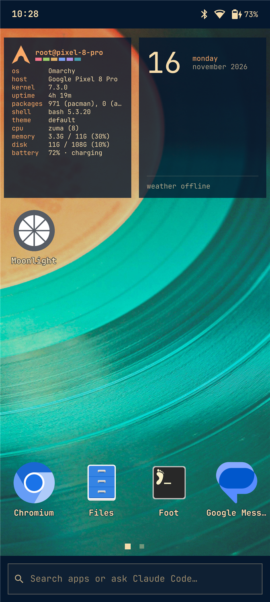
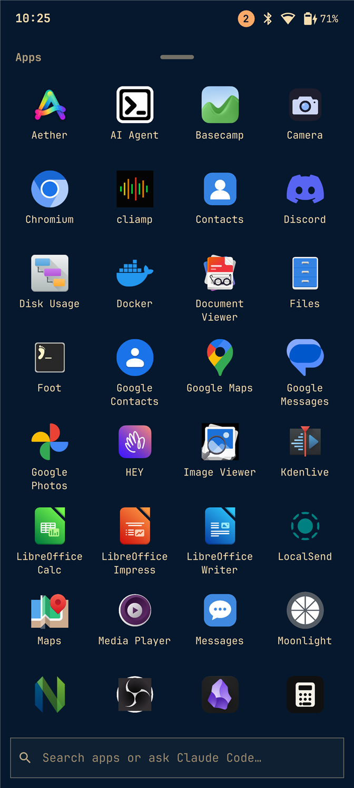

# IT Support Engineer / Systems Administrator

**Endpoint, Identity & Cloud Admin** · Intune, Entra ID, Microsoft 365, Azure, AWS, ServiceNow, AI agents for IT operations · Bilingual (English / Spanish) · Open To Work

My philosophy is that it's best to see problems as new challenges. There is nothing more satisfying than solving an issue or problem you didn't have any knowledge of when you accepted that task or project. With every problem you solve (and I don't mean cheap workarounds and band-aid fixes), you become a tiny bit better in what you do.

## Projects

The first five come from my current job, rewritten for GitHub with no company data.

- [m365-graph-agent-ops](https://github.com/gitColinX/m365-graph-agent-ops) - PowerShell tools I used with Claude Code to do Entra ID, Intune and Exchange Online admin work through Microsoft Graph.
- [ai-ops-agent-workspace](https://github.com/gitColinX/ai-ops-agent-workspace) - One set of instruction files that Claude Code, Codex and Warp all read, so I can switch tools in the middle of a ticket.
- [servicenow-claude-mcp](https://github.com/gitColinX/servicenow-claude-mcp) - Node scripts I used to work ServiceNow tickets from Claude Code through my own OAuth sign-in. I used them to reconcile 860 managed-device serials against 1,078 asset records.
- [kb-to-agent-corpus](https://github.com/gitColinX/kb-to-agent-corpus) - I exported our ServiceNow knowledge base (778 articles, about 15,300 attachments) into Markdown that Claude Code searches first and cites.
- [intune-endpoint-engineering](https://github.com/gitColinX/intune-endpoint-engineering) - Intune Remediations and Win32 packaging scripts. I used them to trace a failing RMM agent install back to my own scripts renaming the vendor's MSI.

Four personal projects:

- [opnsense-unifi-network-playbook](https://github.com/gitColinX/opnsense-unifi-network-playbook) - I rebuilt my home network on a used Lenovo Tiny running OPNsense with UniFi Wi-Fi, using Claude Code over SSH and REST APIs: IDS, ad blocking, IoT and guest VLANs, Tailscale, and 2.3 Gbps with upload lag cut from 121 to 24 ms.
- [usb-builder](https://github.com/gitColinX/usb-builder) - PowerShell that builds a Windows 11 installer USB with Dell drivers, without Rufus.
- [blackarch-over-ssh](https://github.com/gitColinX/blackarch-over-ssh) - I installed BlackArch Linux on a Dell laptop over SSH from a Windows PC, with Claude Code as the operator.
- [job-search-ledger](https://github.com/gitColinX/job-search-ledger) - A local, privacy-first Streamlit job tracker I built during my own search, with pay charts, a weekly work search log and 7 themes including Colorblind Safe and High Contrast.

## Right now: Omarchy Mobile on my Pixel 8 Pro

  
  &nbsp;&nbsp;
  

[Omarchy Mobile](https://omamobile.org) puts Omarchy, a ready-made Linux desktop built on Arch Linux and the Hyprland window manager, on a phone in place of Android, running on the standard Linux kernel instead of Google's Android kernel. It is [Derek Ross's project](https://github.com/derekross/omarchy-mobile).

The Pixel 8 Pro port is a community port. Other contributors wrote most of the kernel drivers; my spare 8 Pro is the third phone testing it, and I contribute test results, firmware tooling and a few small fixes. I run every change on the real phone from a Windows PC over USB and SSH, with Claude Code as the operator. I approve every install to the phone and everything posted to GitHub myself.

**Where the 8 Pro stands in the project's [device table](https://github.com/derekross/omarchy-mobile/blob/main/docs/DEVICES.md)** (as of 16 November 2026):

| Works | Partial | In testing | Not yet |
|---|---|---|---|
| Display at 120 Hz, GPU, touch, buttons, Bluetooth, haptics (vibration), torch | Wi-Fi, battery gauge | Boot, storage, USB networking, charging, speakers and one microphone, NFC | Sleep, modem (calls and mobile data), cameras, sensors, GPS, fingerprint |

It is not a daily phone yet. It can't make calls or sleep, and it draws about half an amp even when idle with the screen off, so a full battery lasted about seven hours in my overnight test.

**What I've contributed** (nine merged pull requests):

- **Bluetooth:** a tool that copies the Bluetooth chip's firmware out of the owner's own Android image (it can't be redistributed), and a fix so Bluetooth starts with the phone's own factory address instead of a placeholder ([#722](https://github.com/derekross/omarchy-mobile/pull/722), [#746](https://github.com/derekross/omarchy-mobile/pull/746), [#752](https://github.com/derekross/omarchy-mobile/pull/752)).
- **Haptics:** the same tool for the vibration motor's firmware ([#722](https://github.com/derekross/omarchy-mobile/pull/722), [#746](https://github.com/derekross/omarchy-mobile/pull/746)).
- **Sleep (groundwork, not working yet):** set the phone's default sleep mode to suspend-to-idle, the light one its hardware can wake from, in both the device package and the kernel, and wrote a step-by-step test plan for getting sleep working safely ([#656](https://github.com/derekross/omarchy-mobile/pull/656), [kernel #244](https://github.com/derekross/linux-omarchy-mobile/pull/244), [#724](https://github.com/derekross/omarchy-mobile/pull/724)).
- **Clock:** a hardware-description fix in the kernel so the phone's clock chip can raise an alarm, which is what lets a sleeping phone wake itself at a set time ([kernel #243](https://github.com/derekross/linux-omarchy-mobile/pull/243)).
- **Test notes from a third phone:** hardware facts, and results from my phone confirming that Bluetooth, haptics and the torch work, which let the device table list them as "works"; the drivers themselves are by other contributors ([#552](https://github.com/derekross/omarchy-mobile/pull/552), [#802](https://github.com/derekross/omarchy-mobile/pull/802)).

**In review now:** two early dry-run stages of the sleep test plan passing on my phone, before any real sleep is attempted ([#835](https://github.com/derekross/omarchy-mobile/pull/835)), and a kernel fix so the phone stays off when it is powered off ([kernel #262](https://github.com/derekross/linux-omarchy-mobile/pull/262)).

My forks: [omarchy-mobile](https://github.com/gitColinX/omarchy-mobile) · [the kernel](https://github.com/gitColinX/linux-omarchy-mobile)

## How I work with AI

Claude Code is my main tool. When I hit my usage limit, I point Codex or ChatGPT at the same instruction files. I sign in myself, so the agent never has my password, and I approve and check every production change.

## Skills

Also: Exchange Online, SharePoint, Teams, Conditional Access, Autopilot, CrowdStrike, Sysinternals.

## Certifications

| Area | Certifications |
|---|---|
| **Security** |         |
| **Microsoft** |    |
| **AWS** |    |
| **Infrastructure & Networking** |     |
| **ITSM** |    |
| **AI** |   |
| **Other** |  |

## Get in touch

